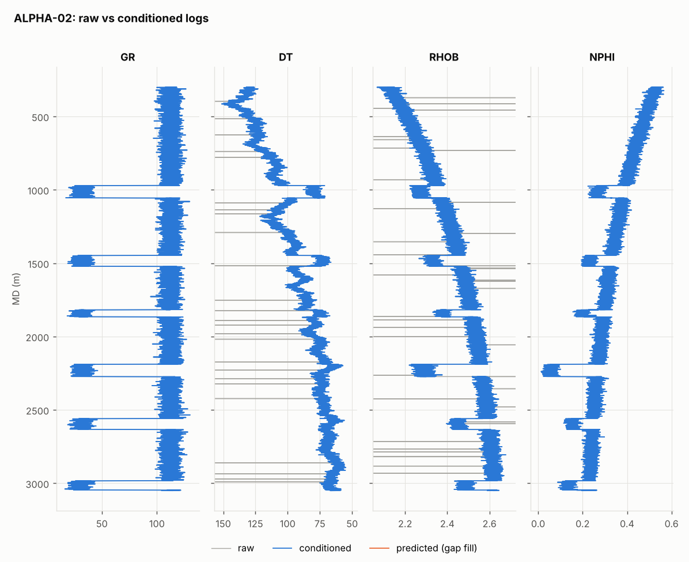
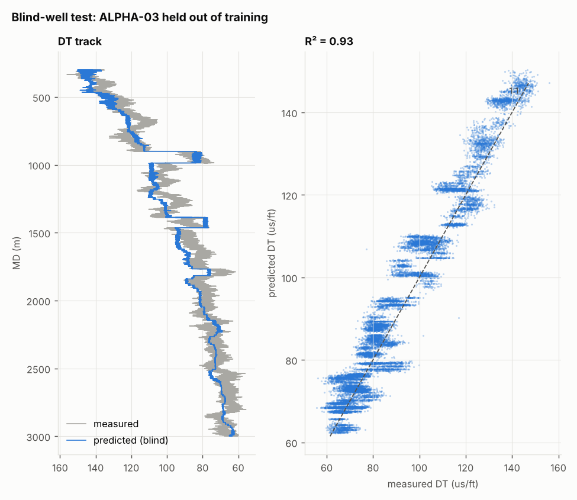
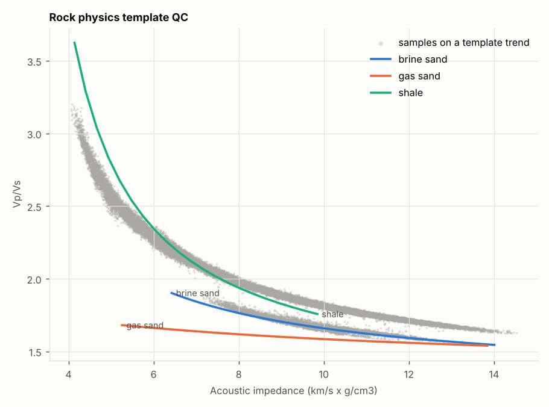
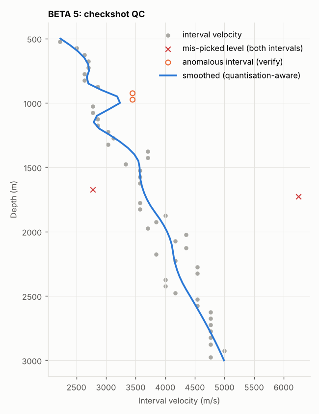

# wellqc: automated audit and conditioning of legacy well data

[](https://github.com/efeakp/ep-well-data-qc/actions/workflows/ci.yml)


Exploration teams inherit well data from many projects, vintages and contractors. The same well turns up under three names. Units are mislabelled. Logs carry spikes, filler values and undeclared nulls. Seismic files arrive truncated. Before any regional study, all of this has to become **one reliable, standardised dataset**.

`wellqc` is a Python pipeline that does that audit automatically. You point it at legacy project folders (Petrel ASCII exports, LAS, checkshots, SEG-Y). It returns:

- **One master well table**, with one master UWI per physical well and every legacy name and UWI kept as an alias
- **Conditioned LAS files**: nulls fixed, impossible values removed, spikes and flat-line filler nulled, runs depth-matched and spliced, units standardised
- **Predicted missing curves**: sonic (DT) by machine learning with blind-well validation, and synthetic shear (Vs) from rock physics, both QC'd against a rock physics template
- **An issues register** graded critical, major or minor, a **quality score** for every curve, and a **processing lineage** recording every change
- **A Markdown audit report** with figures

```
pip install -e .
wellqc demo                                   # synthetic dataset -> full audit in ~15 s
wellqc audit path/to/projectA path/to/projectB --out results/
```

---

## What it found on real legacy data

The pipeline was developed against three real legacy Petrel project exports. Those data are not included in this repo. Between them they hold 41 files: LAS logs, deviation surveys, well headers, tops, checkshots and two 3D SEG-Y volumes. The automated audit found:

| Finding | Detail |
|---|---|
| **Duplicate wells across projects** | 14 well records were only 12 physical wells. Two wells had been loaded into two projects under different names and UWIs. Identical location, TD, trajectory and curve samples confirmed it |
| **Truncated SEG-Y** | 1,108 of 94,472 traces were missing and the file ended mid-trace |
| **Non-standard SEG-Y headers** | Inline and crossline were at bytes 5/21 and coordinates at 73/77, with the standard 189/193/181/185 locations empty. The two volumes turned out to share one bin grid, so they are crops of the same survey |
| **Mislabelled units** | Neutron porosity was labelled m3/m3 but stored in percent in 8 wells. VSH was labelled % but stored as a fraction |
| **Logs below TD** | In 5 wells, by up to 88 m |
| **Filler values** | A GR curve held one constant value for 1,650 m, and a resistivity curve for 188 m |
| **Naming conflicts** | 10 deviation files named their well differently from the header: a legacy `CORE-xx` scheme in one project and a one-letter typo of the field name in another. They were matched by wellhead location or fuzzy name and the conflicts logged |
| **Checkshot problems** | Unlabelled datum, reversed column order, and interval-velocity anomalies separated from 1 ms rounding noise |
| **Sonic prediction** | Blind-well R² of 0.65–0.78 where the data are consistent. Two wells failed the blind test and were flagged: their sonic or input curves disagree with the rest of the area, which is itself a QC finding |

---

## Demo on synthetic data

`wellqc.synthetic` builds a fictional two-project field from a layered rock physics model. The model includes compaction, a gas sand fluid-substituted with Gassmann, and noise. It then injects the same kinds of defect found in real data. The test suite checks that every one is caught:

| # | Injected defect | Caught as |
|---|---|---|
| 1 | Well reloaded in a second project under a new name and UWI | critical: duplicate, merged under one master UWI |
| 2 | Sign-flipped nulls (`+999.25`) in DT; density spikes | major: undeclared nulls; minor: spikes removed |
| 3 | 120 m of constant GR filler | major: flat-line nulled |
| 4 | Logs 18 m below header TD | major: depth inconsistency |
| 5 | Deviation files named `ALPHAA-02` (typo) and `CORE-04` (legacy name) | major: matched by fuzzy name / wellhead location |
| 6 | NPHI in % labelled m3/m3; VSH fraction labelled % | major/minor: rescaled, labels corrected |
| 7 | One well with no sonic; no shear anywhere | DT predicted (blind-well R² ≈ 0.93); Vs synthesised |
| 8 | Two logging runs, the deep run 2.4 m off depth | major: shift found by GR cross-correlation, then spliced |
| 9 | Checkshot with swapped columns, 1 ms rounding, one mis-picked level | mis-pick isolated at 1,700 m; rounding scatter not flagged |
| 10 | SEG-Y truncated, with non-standard header bytes | critical: 37 traces missing; major: byte locations |
| 11 | No CRS in deviation files; extra columns in the header file | major/minor |

The full output is in [`docs/sample_report.md`](docs/sample_report.md).

| Log conditioning | Missing sonic, blind-well test |
|---|---|
|  |  |

| Rock physics template QC | Checkshot QC |
|---|---|
|  |  |

---

## How it works

```mermaid
flowchart LR
    A[Legacy project folders] --> B[Discover<br/>identify file type by content]
    B --> C[Read & reconcile<br/>name / UWI / location matching]
    C --> D[Standardise<br/>units, mnemonics, depth basis]
    D --> E[Duplicates<br/>master UWI + aliases]
    E --> F[Condition<br/>nulls, limits, despike,<br/>flat-lines, depth-match, splice]
    F --> G[Predict<br/>DT by ML, Vs by rock physics]
    G --> H[QC<br/>RPT, checkshots, seismic]
    H --> I[Outputs<br/>master table, LAS, issues,<br/>scores, lineage, report]
```



| Step | Method |
|---|---|
| **File discovery** | Files are identified by their content, not their extension. Legacy folders contain `GAM11` with no extension, `.dat` tops and `.txt` headers |
| **Well reconciliation** | Each well is matched in order: exact name, then fuzzy name (same well number, similar root), then UWI, then wellhead location within 2 m. Every non-exact match is logged |
| **Duplicate detection** | Pairs are compared on surface distance, KB, TD, bottom-hole location and sample-by-sample curve equality. Confirmed duplicates share a master UWI |
| **Units** | Depths are converted to one basis (m or ft). Percent/fraction scaling is detected from the data, so a wrong label is corrected rather than trusted |
| **Conditioning** | Undeclared nulls (including `+999.25`) are removed first. Then come curve-specific physical limits, then a rolling-median/MAD despike with a curve-specific floor (log scale for resistivity), then flat-line detection |
| **Depth matching** | Overlapping runs are aligned on GR by normalised cross-correlation and spliced, with the shallow run taking priority |
| **Sonic prediction** | Gradient boosting on GR, RHOB, NPHI and TVDSS is trained per spatial area, using one copy of each physical well so duplicates can't leak into validation. Each well is held out in turn (leave-one-well-out) |
| **Shear** | Greenberg–Castagna (1992) with sand and shale end members, using Vsh from a GR index |
| **RPT QC** | Brine-sand (Raymer–Hunt–Gardner + Greenberg–Castagna), gas-sand (Gassmann) and shale (Castagna mudrock + Gardner) trends are plotted in AI vs Vp/Vs. Samples far from every trend are flagged |
| **Checkshots** | Two opposite interval-velocity deviations either side of one level mark a mis-picked level. A single deviation is reported as "verify" (it may be a thin layer). Scatter within rounding and pick noise is not flagged. A smoothing spline gives the cleaned profile |
| **SEG-Y** | Raw-byte scan using `numpy.memmap`, so it works on files standard readers refuse. It detects header byte locations, fits the inline/crossline-to-XY grid, compares grids between surveys, and counts truncation and dead traces |
| **Quality score** | 50 × coverage + 30 × validity + 20 × continuity, per curve |

## Where this fits in a Petrel / Techlog / Studio workflow

Python does the heavy lifting before data reach the interpretation platforms:

| Task | This repo | Platform step |
|---|---|---|
| Inventory, audit and standardise legacy data | ✅ | |
| Despike, normalise, depth-match and splice logs | ✅ | Final review in Techlog |
| Predict DT and Vs and QC against an RPT | ✅ | Calibrate the RPT to the basin |
| UWI, naming, CRS and datum validation | ✅ | Load against the corporate standard |
| Checkshot and VSP clean-up | ✅ | Seismic-well tie in Petrel |
| Load into Petrel/Techlog and sync with Studio | outputs are load-ready LAS + CSV | Petrel/Studio (scriptable through Ocean, Cegal Prizm or OSDU APIs) |

## Outputs

```
results/
├── audit_report.md          # summary report with figures
├── well_master.csv          # one row per physical well: master UWI, aliases, legacy UWIs
├── duplicates.csv           # evidence for every duplicate pair
├── issues.csv               # every finding: severity, category, well, curve, source file
├── curve_scores.csv         # 0-100 quality score per curve
├── lineage.csv              # every processing step, with parameters and counts
├── prediction_validation.csv
├── segy.csv
├── checkshot_qc_<well>.csv
├── las/W0001_<WELL>.las      # conditioned logs + DT_PRED + DTS_SYN per physical well
└── figures/
```

## Project layout

```
src/wellqc/
├── io/            # readers: Petrel well head/deviation/tops, LAS, checkshot, SEG-Y scan, file sniffing
├── standardise.py # mnemonics, units, names, duplicates, master UWIs
├── condition.py   # nulls, limits, despike, flat-lines, depth match, splice
├── rockphysics.py # Gardner, Castagna, Greenberg-Castagna, Gassmann, RPT, ML prediction
├── checkshots.py  # time-depth QC
├── pipeline.py    # end-to-end audit
├── report.py      # scoring and report
├── synthetic.py   # demo dataset with injected defects
└── cli.py
```

## Limitations and next steps

- **CRS:** the audit flags undefined coordinate systems but does not reproject. Once the EPSG code is known, transforms belong in `pyproj`.
- **Formats:** LIS/DLIS (via `dlisio`) and raster-log digitisation are not yet supported.
- **Sonic prediction:** the model is deliberately simple and area-local. Adding uncertainty bands (quantile regression) and facies-aware features would be the next step.
- **Rock physics template:** it uses generic end members. In production it should be calibrated per basin, for example against measured DTS.

## References

Castagna, Batzle & Eastwood (1985), *Geophysics* 50(4) · Gardner, Gardner & Gregory (1974), *Geophysics* 39(6) · Greenberg & Castagna (1992), *Geophysical Prospecting* 40 · Gassmann (1951) · Raymer, Hunt & Gardner (1980), SPWLA · Ødegaard & Avseth (2004), *First Break* 22.

## Licence

MIT. Built by [Efe Akpovwovwo](https://github.com/efeakp).
