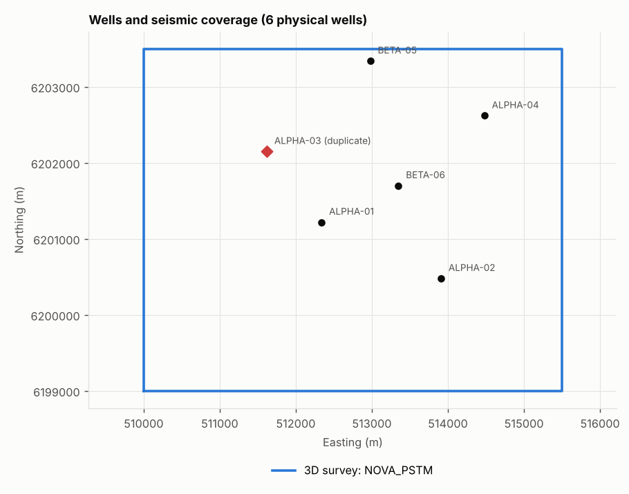

# Well data audit report

Files scanned: **20** · physical wells: **6** · issues: **3 critical, 19 major, 40 minor**

## Well master (one row per physical well)

| master_uwi | standard_name | x | y | kb | td | depth_unit | projects | aliases | legacy_uwis | n_sources |
|---|---|---|---|---|---|---|---|---|---|---|
| W0001 | ALPHA-01 | 512340.0 | 6201220.0 | 25.0 | 2950.01 | m | ALPHA_2009 | ALPHA-01 | NV0001-A | 1 |
| W0002 | ALPHA-02 | 513910.0 | 6200480.0 | 26.0 | 3032.0 | m | ALPHA_2009 | ALPHA-02;ALPHAA-02 | NV0002-A | 1 |
| W0003 | ALPHA-03 | 511620.0 | 6202150.0 | 25.0 | 2999.99 | m | ALPHA_2009;BETA_2014 | ALPHA-03;BETA 7 | NV0003-A;NVB07 | 2 |
| W0004 | ALPHA-04 | 514480.0 | 6202620.0 | 24.0 | 2899.99 | m | ALPHA_2009 | ALPHA-04;CORE-04 | NV0004-A | 1 |
| W0005 | BETA-05 | 512980.0 | 6203340.0 | 18.0 | 3100.0 | m | BETA_2014 | BETA 5 | NVB05 | 1 |
| W0006 | BETA-06 | 513350.0 | 6201700.0 | 18.0 | 3080.0 | m | BETA_2014 | BETA 6 | NVB06 | 1 |

## Duplicate wells across projects

| well_a | uwi_a | project_a | well_b | uwi_b | project_b | surface_dist | kb_match | td_match | bottomhole_dist | curves_identical | identical_curves | verdict |
|---|---|---|---|---|---|---|---|---|---|---|---|---|
| ALPHA-03 | NV0003-A | ALPHA_2009 | BETA 7 | NVB07 | BETA_2014 | 0.0 | True | True | 0.0 | 5/6 | CALI,DT,GR,RDEEP,RHOB | duplicate |

## Issues

| severity | category | message | well | curve | source |
|---|---|---|---|---|---|
| critical | duplicate | Same physical well as BETA 7 (BETA_2014, UWI NVB07): identical location, TD and trajectory; curves identical 5/6 | ALPHA-03 |  |  |
| critical | segy | File ends with a partial trace (500 bytes); file is truncated |  |  | BETA_2014/NOVA_PSTM.segy |
| critical | segy | 37 of 2576 traces missing (last complete trace IL 1056 XL 2009); re-export from source |  |  | BETA_2014/NOVA_PSTM.segy |
| major | checkshot | 1 mis-picked level(s) at depth 1700: the intervals above and below deviate in opposite directions; excluded | BETA 5 |  |  |
| major | crs | Coordinate reference system is <Undefined> | ALPHA-01 |  | ALPHA_2009/ALPHA-01.dev |
| major | crs | Coordinate reference system is <Undefined> | ALPHA-02 |  | ALPHA_2009/ALPHA-02.dev |
| major | crs | Coordinate reference system is <Undefined> | ALPHA-03 |  | ALPHA_2009/ALPHA-03.dev |
| major | crs | Coordinate reference system is <Undefined> | ALPHA-04 |  | ALPHA_2009/ALPHA-04.dev |
| major | crs | Coordinate reference system is <Null> | BETA 5 |  | BETA_2014/BETA 5.dev |
| major | crs | Coordinate reference system is <Null> | BETA 6 |  | BETA_2014/BETA 6.dev |
| major | crs | Coordinate reference system is <Null> | BETA 7 |  | BETA_2014/BETA 7.dev |
| major | depth | Deviation survey ends at 3050.0 but header TD is 3032.0 m | ALPHA-02 |  |  |
| major | depth | Logs extend 18.0 m below stated TD 3032; TD or depth reference inconsistent | ALPHA-02 |  |  |
| major | depth | Logging run BETA 6_run2.las is off depth by +2.44 m relative to BETA 6_run1.las (GR correlation 0.95); shifted before splicing | BETA 6 |  | BETA 6_run2.las |
| major | flatline | Constant value 77.94 from 1000.0 to 1120.0 m (120 m); nulled as fill/filler | ALPHA-01 | GR |  |
| major | naming | Deviation file names the well 'ALPHAA-02' but it was matched to 'ALPHA-02' by similar name | ALPHA-02 |  | ALPHA-02.dev |
| major | naming | Deviation file names the well 'CORE-04' but it was matched to 'ALPHA-04' by wellhead location | ALPHA-04 |  | ALPHA-04.dev |
| major | nulls | 25 undeclared null values (e.g. +999.25) set to null | ALPHA-02 | DT |  |
| major | segy | Inline/crossline stored at non-standard bytes 5/21 (TRACE_SEQUENCE_FILE/CDP); bytes 189/193 are empty. Set these byte locations explicitly on load. |  |  | BETA_2014/NOVA_PSTM.segy |
| major | units | NPHI labelled 'm3/m3' but values are in percent (p99 = 51.5); divided by 100 | BETA 5 | NPHI |  |
| major | units | NPHI labelled 'm3/m3' but values are in percent (p99 = 52.2); divided by 100 | BETA 6 | NPHI |  |
| major | units | NPHI labelled 'm3/m3' but values are in percent (p99 = 51.4); divided by 100 | BETA 7 | NPHI |  |
| minor | checkshot | 2 anomalous interval velocities (900-950, 950-1000): thin layer or pick error; verify against sonic | BETA 5 |  |  |
| minor | crs | Azimuth reference (true/grid north) undefined | ALPHA-01 |  | ALPHA_2009/ALPHA-01.dev |
| minor | crs | Azimuth reference (true/grid north) undefined | ALPHA-02 |  | ALPHA_2009/ALPHA-02.dev |
| minor | crs | Azimuth reference (true/grid north) undefined | ALPHA-03 |  | ALPHA_2009/ALPHA-03.dev |
| minor | crs | Azimuth reference (true/grid north) undefined | ALPHA-04 |  | ALPHA_2009/ALPHA-04.dev |
| minor | crs | Azimuth reference (true/grid north) undefined | BETA 5 |  | BETA_2014/BETA 5.dev |
| minor | crs | Azimuth reference (true/grid north) undefined | BETA 6 |  | BETA_2014/BETA 6.dev |
| minor | crs | Azimuth reference (true/grid north) undefined | BETA 7 |  | BETA_2014/BETA 7.dev |
| minor | format | Row has 11 values but header defines 8 fields | ALPHA-01 |  | ALPHA_2009/well_header.txt |
| minor | format | Row has 11 values but header defines 8 fields | ALPHA-02 |  | ALPHA_2009/well_header.txt |
| minor | format | Row has 11 values but header defines 8 fields | ALPHA-03 |  | ALPHA_2009/well_header.txt |
| minor | format | Row has 11 values but header defines 8 fields | ALPHA-04 |  | ALPHA_2009/well_header.txt |
| minor | format | Ambiguous coordinate column names ['Surface', 'Surface.1']; assumed X then Y |  |  | BETA_2014/well_header.txt |
| minor | metadata | LAS header FIELD is empty | ALPHA-01 |  | ALPHA_2009/ALPHA-01.las |
| minor | metadata | LAS header COMPANY is empty | ALPHA-01 |  | ALPHA_2009/ALPHA-01.las |
| minor | metadata | LAS header FIELD is empty | ALPHA-02 |  | ALPHA_2009/ALPHA-02.las |
| minor | metadata | LAS header COMPANY is empty | ALPHA-02 |  | ALPHA_2009/ALPHA-02.las |
| minor | metadata | LAS header FIELD is empty | ALPHA-03 |  | ALPHA_2009/ALPHA-03.las |
| minor | metadata | LAS header COMPANY is empty | ALPHA-03 |  | ALPHA_2009/ALPHA-03.las |
| minor | metadata | LAS header FIELD is empty | ALPHA-04 |  | ALPHA_2009/ALPHA-04.las |
| minor | metadata | LAS header COMPANY is empty | ALPHA-04 |  | ALPHA_2009/ALPHA-04.las |
| minor | metadata | LAS header FIELD is empty | BETA 5 |  | BETA_2014/BETA 5.las |
| minor | metadata | LAS header COMPANY is empty | BETA 5 |  | BETA_2014/BETA 5.las |
| minor | metadata | LAS header FIELD is empty | BETA 6 |  | BETA_2014/BETA 6_run1.las |
| minor | metadata | LAS header COMPANY is empty | BETA 6 |  | BETA_2014/BETA 6_run1.las |
| minor | metadata | LAS header FIELD is empty | BETA 6 |  | BETA_2014/BETA 6_run2.las |
| minor | metadata | LAS header COMPANY is empty | BETA 6 |  | BETA_2014/BETA 6_run2.las |
| minor | metadata | LAS header FIELD is empty | BETA 7 |  | BETA_2014/BETA 7.las |
| minor | metadata | LAS header COMPANY is empty | BETA 7 |  | BETA_2014/BETA 7.las |
| minor | metadata | Header file does not state XY or depth units |  |  | BETA_2014/well_header.txt |
| minor | range | 4 samples outside physical range [1.2, 3.2] set to null | ALPHA-02 | RHOB |  |
| minor | segy | Coordinates stored in bytes 73/77 (SOURCE_X), not CDP_X/CDP_Y (181/185) |  |  | BETA_2014/NOVA_PSTM.segy |
| minor | spike | 37 spikes removed | ALPHA-02 | RHOB |  |
| minor | spike | 1 spikes removed | ALPHA-02 | RDEEP |  |
| minor | spike | 2 spikes removed | ALPHA-04 | RDEEP |  |
| minor | spike | 1 spikes removed | BETA 6 | RDEEP |  |
| minor | units | VSH labelled '%' but values are fractions (p99 = 0.86); label corrected | ALPHA-01 | VSH |  |
| minor | units | VSH labelled '%' but values are fractions (p99 = 0.86); label corrected | ALPHA-02 | VSH |  |
| minor | units | VSH labelled '%' but values are fractions (p99 = 0.86); label corrected | ALPHA-03 | VSH |  |
| minor | units | VSH labelled '%' but values are fractions (p99 = 0.86); label corrected | ALPHA-04 | VSH |  |

## Curve quality (key curves, mean score per well)

| well | key_curve_score |
|---|---|
| ALPHA-02 | 93.5 |
| ALPHA-01 | 98.9 |
| ALPHA-04 | 99.2 |
| BETA 6 | 99.6 |
| ALPHA-03 | 100.0 |
| BETA 5 | 100.0 |
| BETA 7 | 100.0 |

## SEG-Y

| project | file | inlines | xlines | il/xl bytes | xy bytes | bin (m) | time (ms) | traces | missing |
|---|---|---|---|---|---|---|---|---|---|
| BETA_2014 | NOVA_PSTM.segy | (1001, 1056) | (2001, 2046) | 5/21 | 73/77 | 100.0 x 100.0 | 1500-3000 | 2539 | 37 |

## Checkshots

| well | levels | top | base | vint_min | vint_max | vint_smooth_range | flagged |
|---|---|---|---|---|---|---|---|
| BETA 5 | 51 | 500.0 | 3000.0 | 2222 | 6250 | 2229-4992 | 3 |

## Missing-curve prediction: blind-well validation

| blind_well | n | rmse | mae | r2 | area_wells |
|---|---|---|---|---|---|
| BETA 6 | 18241 | 6.717 | 5.284 | 0.925 | 6 |
| BETA 5 | 18373 | 5.475 | 4.337 | 0.947 | 6 |
| ALPHA-03 | 17717 | 5.947 | 4.83 | 0.93 | 6 |
| ALPHA-02 | 18020 | 6.28 | 4.868 | 0.922 | 6 |
| ALPHA-01 | 17389 | 6.48 | 5.271 | 0.935 | 6 |

## Figures

## Scoring method

Curve score = 50 x coverage of the well's logged interval + 30 x share of raw samples that passed null, physical-limit, despike and flat-line checks + 20 x continuity (1 / (1 + gaps/10)).

## Processing lineage
34 recorded steps; full detail in `lineage.csv`.
